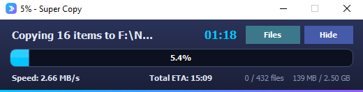
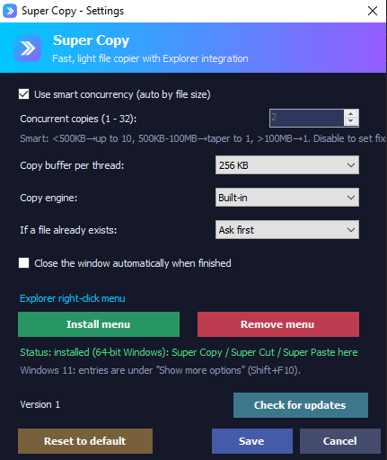

<div dir="rtl">

<div align="center">

<p>
  <a href="README.md"></a>
  <a href="README.ar.md"></a>
  <a href="README.fr.md"></a>
</p>

## ⚡ أُنشئ هذا المشروع باستخدام [opencode](https://github.com/anomalyco/opencode) CLI

**نماذج مجانية: Big Pickle وDeepSeek V4**

# 🚀 Super Copy

**ناسخ ملفات خفيف متعدد الخيوط لويندوز XP → 11**<br>
مع تكامل سلس في قائمة النقر بزر الماوس الأيمن في المستكشف

[](HISTORY.md)
[](https://opensource.org/licenses/MIT)
[](https://github.com/youcef07dz/super-copy)
[](https://github.com/youcef07dz/super-copy)
[](https://github.com/youcef07dz/super-copy)
[](https://github.com/youcef07dz/super-copy/stargazers)
[](https://github.com/youcef07dz/super-copy/releases)

[**⬇ تنزيل SuperCopy.exe**](https://github.com/youcef07dz/super-copy/raw/refs/heads/main/SuperCopy.exe) ·
[📖 المزايا](#-المزايا) ·
[💬 الإبلاغ عن مشكلة](https://github.com/youcef07dz/super-copy/issues) ·
[⭐ إضافة نجمة](https://github.com/youcef07dz/super-copy/stargazers)

</div>

> [!TIP]
> **جديد في v4:** قائمة الملفات أصبحت لها **شرائط تمرير خاصة بها** (انقر للقفز، اسحب المقبض)، والسطر تحت مؤشر الماوس يظهر بتظليل منفصل، والتطبيق **DPI aware** - أعمدة وارتفاعات صفوف واضحة عند 125-200٪. تكلفة التحقق انخفضت للنصف: تُحسب بصمة المصدر *أثناء النسخ*.
>
> **جديد في v3:** يمكن أن يصبح Super Copy هو **النسخ الافتراضي**: اضغط `Ctrl+V` داخل نافذة مجلد فيتم اللصق بواسطة Super Copy (نفس المحرك ونفس قواعد التعارض وتحقق XXH3). يمكن تشغيله أو إيقافه من الإعدادات.
>
> **جديد في v2:** يتم التحقق من كل عملية نسخ أو نقل باستخدام **XXH3-64**. عند عدم التطابق يُحذف النسخ التالف، وتُستعاد النسخة التي تم استبدالها، ويبقى المصدر سليماً.

---

<details>
<summary><b>📑 جدول المحتويات</b></summary>

- [✨ المزايا](#-المزايا)
- [⚡ بدء سريع](#-بدء-سريع)
- [📥 التنزيل](#-التنزيل)
- [💻 سطر الأوامر](#-سطر-الأوامر)
- [🛠 البناء](#-البناء)
- [📷 لقطات الشاشة](#-لقطات-الشاشة)
- [📝 ملاحظات](#-ملاحظات)
- [🗂 السجل](#-السجل)
- [🤝 المساهمة](#-المساهمة)
- [📄 الترخيص](#-الترخيص)

</details>

---

## ✨ المزايا

- ⚡ **سريع** — نسخ متعدد الخيوط مع تزامن ذكي يُضبط تلقائياً حسب حجم الملف.
- 🖱 **تكامل المستكشف** — نسخ، قص/نقل، نسخ إلى مجلد… من قائمة النقر الأيمن، مع **لصق هنا** على خلفية المجلد.
- ⭐ **نسخ افتراضي** — مساعد يعمل في الخلفية: `Ctrl+V` داخل نافذة المجلد يتم تنفيذه بواسطة Super Copy (مفعّل افتراضياً، ويمكن إيقافه من الإعدادات).
- 🔧 **محركان** — محرك مدمج أو Robocopy من ويندوز اختيارياً.
- ⚖ **معالجة التعارضات** — استبدال، تخطي، الاحتفاظ بالاثنين (إعادة تسمية)، استبدال إذا كان أحدث، أو السؤال أولاً.
- 📊 **ترتيب ذكي** — الملفات الكبيرة أولاً لتحسين الإنتاجية.
- 🛡 **أمان موثّق** — تحقق XXH3-64 في كل نسخ ونقل، وفحص المساحة الحرة، ونسخ احتياطي/استعادة عند الاستبدال.
- 🎯 **الراحة** — السحب والإفلات، الوضع المضغوط، تقرير أخطاء مع النسخ إلى الحافظة.
- 🌍 **اللغات** — الإنجليزية والعربية والفرنسية، أو تلقائي (لغة ويندوز)؛ دعم كامل للاتجاه من اليمين إلى اليسار.
- 📦 **محمول** — ملف واحد، بلا مثبّت وبلا صلاحيات مسؤول؛ الإعدادات والحافظة تُكتبان بشكل ذرّي.

---

## ⚡ بدء سريع

1. **نزّل** [`SuperCopy.exe`](https://github.com/youcef07dz/super-copy/raw/refs/heads/main/SuperCopy.exe) — ملف محمول واحد، بلا مثبّت.
2. **شغّله مرة واحدة** — تفتح لوحة الإعدادات.
3. **ثبّت القائمة** — اضغط **تثبيت القائمة** (أو شغّل `SuperCopy.exe /install`).
4. **انقر بزر الماوس الأيمن** على أي ملف أو مجلد ← **Super Copy** ← نسخ / قص / نسخ إلى مجلد…
5. **الصق** — انقر بزر الماوس الأيمن على مساحة فارغة داخل مجلد ← **لصق هنا**.
6. **اختياري** — من الإعدادات فعّل **«استخدام Super Copy كنسخ افتراضي»**: عندها يصبح `Ctrl+V` داخل نافذة المجلد ينفّذه Super Copy.

> [!TIP]
> لا حاجة إلى صلاحيات المسؤول — تُثبّت القائمة للمستخدم الحالي في `HKEY_CURRENT_USER`.

---

## 📥 التنزيل

<div align="center">

### 🎯 تنزيل مباشر

**SuperCopy.exe** — ملف محمول واحد

<a href="https://github.com/youcef07dz/super-copy/raw/refs/heads/main/SuperCopy.exe">
  
</a>

<sub>بلا مثبّت · بلا صلاحيات مسؤول · شغّله فقط</sub>

</div>

<details>
<summary><b>ملخّص SHA-256</b></summary>

```text
4523E8783D310B8F635ADE13EB99827CD4EC4BE9BD27C2CD5195B728A67109B0
```

</details>

---

## 💻 سطر الأوامر

> [!NOTE]
> يقبل `SuperCopy.exe` الوسائط التالية:

- **`SuperCopy.exe`** — فتح الإعدادات.
- **`SuperCopy.exe /install`** — إضافة إدخالات قائمة النقر بزر الماوس الأيمن.
- **`SuperCopy.exe /uninstall`** — إزالة إدخالات القائمة.
- **`SuperCopy.exe /copy <مسارات...>`** — تذكّر العناصر للنسخ.
- **`SuperCopy.exe /cut <مسارات...>`** — تذكّر العناصر للنقل.
- **`SuperCopy.exe /paste <مجلد>`** — نسخ/نقل العناصر المتذكّرة إلى هنا.
- **`SuperCopy.exe /todevice`** — نسخ العناصر المحددة إلى المجلد المختار.
- **`SuperCopy.exe /agent`** — تشغيل المساعد الذي يتعامل مع `Ctrl+V` داخل المستكشف.
- **`SuperCopy.exe /selftest`** — تشغيل الفحص الذاتي (الخروج 0 إذا سليم).

### أمثلة

```bash
# تثبيت إدخالات قائمة النقر بزر الماوس الأيمن
SuperCopy.exe /install

# تذكّر ملفات/مجلدات للنسخ
SuperCopy.exe /copy "C:\Folder\file1.txt" "D:\Photos\image.jpg"

# لصق العناصر المتذكّرة في وجهة
SuperCopy.exe /paste "E:\Backup\2026"

# التحقق من سلامة التثبيت
SuperCopy.exe /selftest
```

---

## 🛠 البناء

شغّل `build.cmd` من جذر المستودع.

> [!NOTE]
> يستخدم **`csc.exe` من .NET Framework 3.5** (من مجلد `v3.5`) مع ملف **`app.manifest`** صريح بمستوى `asInvoker` (بدون طلب رفع الصلاحيات). يضمّن `SuperCopy.ico` وينتج `SuperCopy.exe` في جذر المستودع.

### متطلبات البناء

- ويندوز XP أو أحدث
- .NET Framework 3.5 مثبّت (يوفّر `csc.exe` للبناء)
- هدف التشغيل هو .NET Framework 2.0+ (مثبّت مسبقاً في ويندوز منذ Vista)
- لا حاجة إلى حزم NuGet خارجية

---

## 📷 لقطات الشاشة

### النافذة الرئيسية


### الوضع المضغوط



### الإعدادات



---

## 📝 ملاحظات

> [!IMPORTANT]
> **مستخدمو ويندوز 11**: تظهر الإدخالات تحت *إظهار المزيد من الخيارات* (أو اضغط `Shift + F10`).

> [!NOTE]
> **تخزين الإعدادات**: في `%APPDATA%\SuperCopy\settings.ini`.

> [!NOTE]
> **النسخة المثبتة**: تعمل قائمة المستكشف والمساعد من `%APPDATA%\SuperCopy\SuperCopyHelper.exe` — باسم مستقل حتى تميّزه عن البرنامج الذي تشغّله في مدير المهام. ويؤدي `/uninstall` إلى إيقاف المساعد وحذف هذا الملف.

> [!TIP]
> **تثبيت القائمة**: يتطلب `/install` (أو زر **تثبيت القائمة** في الإعدادات). **لا حاجة إلى صلاحيات المسؤول.**

> [!IMPORTANT]
> **إذا اشتكى مضاد الفيروسات عندك**: البرنامج `SuperCopy.exe` غير موقّع، لذا فإن مصنف التعلّم الآلي في Windows Defender (أسماء كشف مثل `Trojan:Win32/Wacatac.B!ml` أو `Bearfoos.A!ml`) قد يضع علامة على الملف المنزّل حديثاً أو على النسخة المثبتة في `%APPDATA%\SuperCopy`. السبب نمط قرينة/تعلم آلي (برنامج صغير غير موقّع ينسخ نفسه إلى مجلد المستخدم ويبدأ مع ويندوز) وليس شيئاً وُجد في الكود نفسه.
>
> إذا حُجر الملف عندك:
> 1. تحقق من الملف المنزّل مقابل ملخّص SHA-256 في [قسم التنزيل](#-download) أعلاه.
> 2. استعده من *أمان ويندوز → محفوظات الحماية* (أو أعِد تنزيله من GitHub).
> 3. أضف استثناء مضاد فيروسات للمجلد `%APPDATA%\SuperCopy` حتى تبقى النسخة المثبتة في مكانها.
> 4. ساعد الجميع: أبلغ عن الإنذار الكاذب في صفحة [إرسال الملفات إلى Microsoft Security Intelligence](https://www.microsoft.com/en-us/wdsi/filesubmission) — عادة تُضاف القائمة البيضاء خلال يوم أو يومين.
>
> نسخ [`SuperCopy.exe` الرسمية](https://github.com/youcef07dz/super-copy/releases) تُبنى مرة واحدة ولا يُعاد توليدها بين الإصدارات: الملخّص أعلاه يبقى صالحاً طوال عمر الإصدار.

---

## 🗂 السجل

ما الجديد في الإصدار v4 والإصدارات السابقة: [HISTORY.md](HISTORY.md). الكود والملف التنفيذي للإصدارات v1 و v2 و v3 محفوظة في [`old/v1`](old/v1) و [`old/v2`](old/v2) و [`old/v3`](old/v3).

---

## 🤝 المساهمة

المساهمات مرحّب بها! إليك كيف تساعد:

1. 🍴 **اعمل Fork** للمستودع.
2. 🌿 **أنشئ** فرعاً للميزة (`git checkout -b feature/amazing-feature`).
3. 💾 **أثبت** تغييراتك (`git commit -m 'Add amazing feature'`).
4. 📤 **ادفع** إلى الفرع (`git push origin feature/amazing-feature`).
5. 🔄 **افتح** Pull Request.

### طرق المساهمة

- 🐛 [الإبلاغ عن الأخطاء](https://github.com/youcef07dz/super-copy/issues/new?labels=bug) — ساعدنا في تحسين الاستقرار.
- 💡 [اقتراح ميزات](https://github.com/youcef07dz/super-copy/issues/new?labels=enhancement) — شارك أفكارك.
- ⭐ [إضافة نجمة](https://github.com/youcef07dz/super-copy/stargazers) — أظهر دعمك.
- 📢 شارك مع الآخرين — انشر الخبر.

---

## 📄 الترخيص

هذا المشروع مرخّص بموجب **MIT** — راجع ملف [LICENSE](LICENSE) للتفاصيل.

<div align="center">

**MIT License — مجاني للاستخدام الشخصي والتجاري**

صُنع بـ ❤ بواسطة [**@youcef07dz**](https://github.com/youcef07dz)

[⬆ العودة إلى الأعلى](#-super-copy)

</div>

</div>
