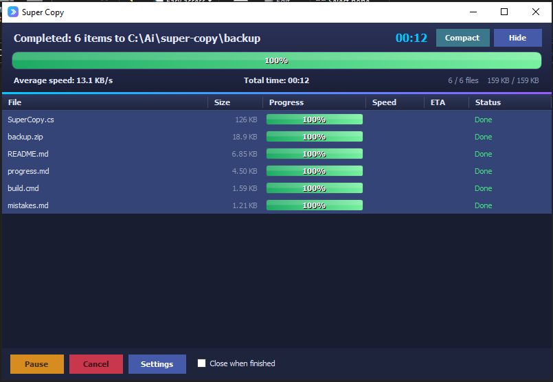

<div dir="rtl">

<div align="center">

<p>
  <a href="README.md"></a>
  <a href="README.ar.md"></a>
  <a href="README.fr.md"></a>
</p>

# 🚀 Super Copy

**ناسخ ملفات خفيف متعدد الخيوط لويندوز XP → 11**<br>
مع تكامل سلس في قائمة النقر بزر الماوس الأيمن في المستكشف

[](https://opensource.org/licenses/MIT)
[](https://github.com/youcef07dz/super-copy)
[](https://github.com/youcef07dz/super-copy)
[](https://github.com/youcef07dz/super-copy)
[](https://github.com/youcef07dz/super-copy)
[](https://github.com/youcef07dz/super-copy)
[](https://github.com/youcef07dz/super-copy/stargazers)
[](https://github.com/youcef07dz/super-copy/releases)

[**⬇ تنزيل SuperCopy.exe**](https://github.com/youcef07dz/super-copy/raw/refs/heads/main/SuperCopy.exe) ·
[📖 التوثيق](#-المزايا) ·
[💬 الإبلاغ عن مشكلة](https://github.com/youcef07dz/super-copy/issues) ·
[⭐ إضافة نجمة](https://github.com/youcef07dz/super-copy/stargazers)

</div>

---

## 📑 جدول المحتويات

- [✨ المزايا](#-المزايا)
- [⚡ بدء سريع](#-بدء-سريع)
- [📥 التنزيل](#-التنزيل)
- [💻 سطر الأوامر](#-سطر-الأوامر)
- [🛠 البناء](#-البناء)
- [📷 لقطات الشاشة](#-لقطات-الشاشة)
- [📝 ملاحظات](#-ملاحظات)
- [🤝 المساهمة](#-المساهمة)
- [📄 الترخيص](#-الترخيص)

---

## ✨ المزايا

|  | الميزة | الوصف |
|:---:|---|---|
| ⚡ | **سريع** | نسخ متعدد الخيوط مع تزامن ذكي يُضبط تلقائياً حسب حجم الملف |
| 🖱 | **تكامل المستكشف** | أوامر القائمة (نسخ، قص/نقل، نسخ إلى مجلد…) + *لصق هنا* على خلفية المجلد |
| 🔧 | **المحركات** | محرك مدمج أو Robocopy من ويندوز اختيارياً |
| ⚖ | **التعارضات** | استبدال · تخطي · الاحتفاظ بالاثنين (إعادة تسمية) · استبدال إذا كان أحدث · السؤال أولاً |
| 📊 | **ترتيب ذكي** | الملفات الكبيرة أولاً لتحسين الإنتاجية |
| 🛡 | **الأمان** | فحص المساحة الحرة، والتحقق بـ MD5 قبل حذف المصدر |
| 🎯 | **الراحة** | السحب والإفلات، الوضع المضغوط، تقرير الأخطاء مع النسخ إلى الحافظة |
| 🌍 | **اللغات** | الإنجليزية والعربية والفرنسية — أو تلقائي (لغة ويندوز)؛ دعم كامل للاتجاه من اليمين إلى اليسار |
| 📦 | **محمول وآمن** | كتابة ذرّية للإعدادات/الحافظة؛ القائمة عبر HKCU |

---

## ⚡ بدء سريع

```
1. التنزيل         →  SuperCopy.exe (ملف محمول واحد، بلا مثبّت)
2. التشغيل مرة     →  يفتح لوحة الإعدادات
3. تثبيت القائمة   →  اضغط «تثبيت القائمة» في الإعدادات (أو شغّل /install)
4. النقر الأيمن    →  الملفات/المجلدات → Super Copy > نسخ / قص / نسخ إلى مجلد...
5. لصق هنا         →  انقر بزر الماوس الأيمن على مساحة فارغة داخل مجلد → لصق هنا
```

> [!TIP]
> لا حاجة إلى صلاحيات المسؤول — تُثبّت القائمة للمستخدم الحالي في `HKEY_CURRENT_USER`.

---

## 📥 التنزيل

<table>
  <tr>
    <td align="center" width="100%">
      <h3>🎯 تنزيل مباشر</h3>
      <p><b>SuperCopy.exe</b> — ملف محمول واحد</p>
      <a href="https://github.com/youcef07dz/super-copy/raw/refs/heads/main/SuperCopy.exe">
        
      </a>
      <p><sub>بلا مثبّت · بلا صلاحيات مسؤول · شغّله فقط</sub></p>
    </td>
  </tr>
</table>

---

## 💻 سطر الأوامر

> [!NOTE]
> يقبل `SuperCopy.exe` الوسائط التالية:

| الأمر | الإجراء |
|---|---|
| `SuperCopy.exe` | فتح الإعدادات |
| `SuperCopy.exe /install` | إضافة إدخالات قائمة النقر بزر الماوس الأيمن |
| `SuperCopy.exe /uninstall` | إزالة إدخالات قائمة النقر بزر الماوس الأيمن |
| `SuperCopy.exe /copy <مسارات...>` | تذكّر العناصر للنسخ |
| `SuperCopy.exe /cut <مسارات...>` | تذكّر العناصر للنقل |
| `SuperCopy.exe /paste <مجلد>` | نسخ/نقل العناصر المتذكّرة إلى هنا |
| `SuperCopy.exe /todevice` | نسخ العناصر المحددة إلى المجلد المختار |
| `SuperCopy.exe /selftest` | تشغيل الفحص الذاتي (الخروج 0 إذا سليم) |

### أمثلة

```bash
# تثبيت إدخالات قائمة النقر بزر الماوس الأيمن
SuperCopy.exe /install

# تذكّر ملفات/مجلدات للنسخ
SuperCopy.exe /copy "C:\Folder\file1.txt" "D:\Photos\image.jpg"

# لصق العناصر المتذكّرة في وجهة
SuperCopy.exe /paste "E:\Backup\2026"

# التحقق من سلامة التثبيت
SuperCopy.exe /selftest
```

---

## 🛠 البناء

```bash
build.cmd
```

> [!NOTE]
> يستخدم **csc.exe من .NET Framework 2.0** (مضمّن في ويندوز). يضمّن `SuperCopy.ico` وينتج `SuperCopy.exe` في جذر المستودع.

### متطلبات البناء

- ويندوز XP أو أحدث
- .NET Framework 2.0+ (مثبّت مسبقاً في ويندوز منذ Vista)
- لا حاجة إلى حزم NuGet خارجية

---

## 📷 لقطات الشاشة

<div align="center">

| النافذة الرئيسية | الوضع المضغوط | الإعدادات |
|:---:|:---:|:---:|
|  |  |  |

</div>

---

## 📝 ملاحظات

> [!IMPORTANT]
> **مستخدمو ويندوز 11**: تظهر الإدخالات تحت *إظهار المزيد من الخيارات* (أو اضغط `Shift + F10`).

> [!NOTE]
> **تخزين الإعدادات**: في `%APPDATA%\SuperCopy\settings.ini`.

> [!TIP]
> **تثبيت القائمة**: يتطلب `/install` (أو زر *تثبيت القائمة* في الإعدادات). **لا حاجة إلى صلاحيات المسؤول.**

---

## 🤝 المساهمة

المساهمات مرحّب بها! إليك كيف تساعد:

1. 🍴 **اعمل Fork** للمستودع
2. 🌿 **أنشئ** فرعاً للميزة (`git checkout -b feature/amazing-feature`)
3. 💾 **أثبت** تغييراتك (`git commit -m 'Add amazing feature'`)
4. 📤 **ادفع** إلى الفرع (`git push origin feature/amazing-feature`)
5. 🔄 **افتح** Pull Request

### طرق المساهمة

- 🐛 [الإبلاغ عن الأخطاء](https://github.com/youcef07dz/super-copy/issues/new?labels=bug) — ساعدنا في تحسين الاستقرار
- 💡 [اقتراح ميزات](https://github.com/youcef07dz/super-copy/issues/new?labels=enhancement) — شارك أفكارك
- ⭐ [إضافة نجمة](https://github.com/youcef07dz/super-copy/stargazers) — أظهر دعمك
- 📢 شارك مع الآخرين — انشر الخبر

---

## 📄 الترخيص

هذا المشروع مرخّص بموجب **MIT** — راجع ملف [LICENSE](LICENSE) للتفاصيل.

<div align="center">

```
MIT License — مجاني للاستخدام الشخصي والتجاري
```

صُنع بـ ❤ بواسطة [**@youcef07dz**](https://github.com/youcef07dz)

[⬆ العودة إلى الأعلى](#-super-copy)

</div>

</div>
